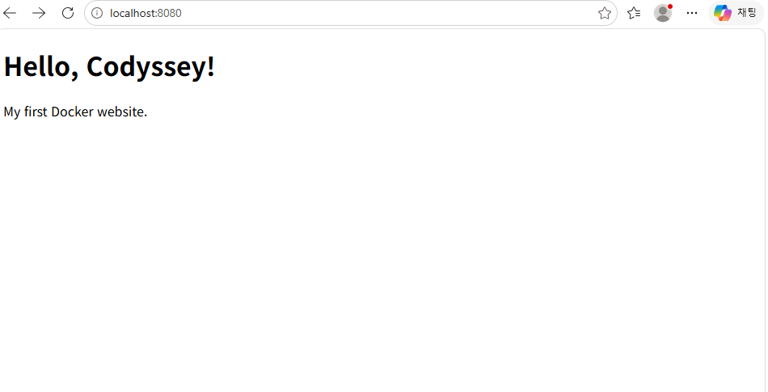
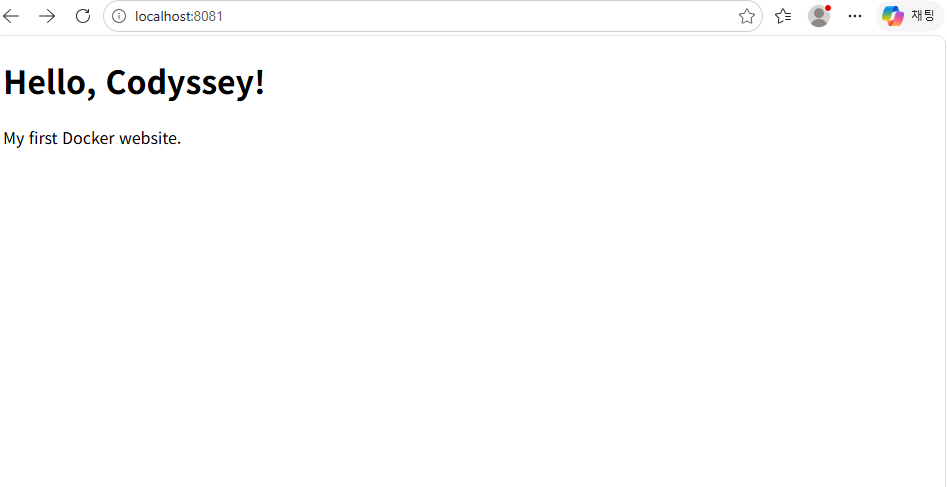
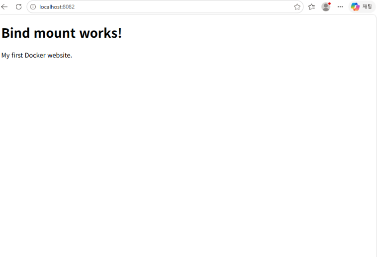
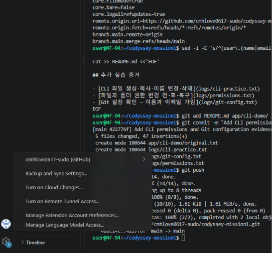

# 개발 작업실 구축 — Codyssey Mission 1

## 프로젝트 소개

Windows에서 WSL Ubuntu, Git, Docker Desktop을 연결하고,
직접 작성한 Dockerfile로 Nginx 웹서버를 실행한 실습 기록입니다.
파일 권한, 포트 연결, 바인드 마운트, 볼륨의 데이터 유지도 확인했습니다.

## 실행 환경

| 항목 | 사용 환경 |
|---|---|
| 호스트 OS | Windows |
| 터미널 | VS Code 통합 터미널 |
| Linux 환경 | WSL 2 / Ubuntu 26.04.1 LTS |
| 셸 | Bash 5.3.9 |
| Git | 2.53.0 |
| Docker Engine | 29.9.2 |
| Docker Desktop | 4.97.0 |
| 실습용 Ubuntu 이미지 | ubuntu:24.04 |
| 웹서버 기반 이미지 | nginx:alpine |

실제 버전 출력: [환경 로그](logs/environment.txt)
Docker 연결 확인: [Docker 버전 로그](logs/docker-version.txt)

## 파일 구성

- `Dockerfile`: Nginx 기반 웹 이미지 제작 방법
- `app/index.html`: 웹페이지
- `app/practice.txt`: CLI 파일 조작 실습 파일
- `logs/`: 실제 명령 실행 결과
- `screenshots/`: 실습 화면 증거를 넣을 폴더

## 웹서버 실행 방법

Docker Desktop을 실행하고 Ubuntu의 WSL integration을 활성화합니다.
저장소를 내려받은 뒤 해당 폴더에서 실행합니다.

```bash
git clone https://github.com/cmhlove0617-sudo/codyssey-mission1.git
cd codyssey-mission1
docker build -t codyssey-web:v1 .
docker run -d --name codyssey-web -p 8080:80 codyssey-web:v1
```

브라우저 접속 주소: http://localhost:8080

이미 같은 이름의 컨테이너가 있으면 새로 만들지 않고 시작합니다.

```bash
docker start codyssey-web
```

### Dockerfile 설명

- `FROM nginx:alpine`: Alpine Linux 기반 Nginx 이미지를 사용합니다.
- `COPY`: 직접 만든 HTML을 Nginx의 웹페이지 경로에 복사합니다.
- `EXPOSE 80`: 컨테이너가 사용하는 포트를 표시합니다.
- 실제 호스트 포트 연결은 실행할 때 `-p 8080:80`으로 설정합니다.

### 다른 포트로 실행

```bash
docker run -d --name codyssey-web-8081 -p 8081:80 codyssey-web:v1
```

http://localhost:8081 에서도 같은 웹페이지가 열리는 것을 확인했습니다.

### 바인드 마운트

저장소 최상위 폴더에서 실행합니다.

```bash
docker run -d --name codyssey-bind -p 8082:80 --mount type=bind,source="$(pwd)/app",target=/usr/share/nginx/html,readonly codyssey-web:v1
```

호스트의 `app/index.html`을 수정한 뒤 http://localhost:8082 를
새로고침하면 이미지를 다시 빌드하지 않아도 변경 내용이 반영됩니다.

실습에서는 제목을 `Hello, Codyssey!`에서 `Bind mount works!`로
변경하여 반영을 확인했습니다. 현재 소스에는 변경된 제목이 저장되어
있으므로 새로 빌드한 이미지에도 `Bind mount works!`가 표시됩니다.

실행 상태 기록: [웹 컨테이너 목록](logs/web-containers.txt)

## 볼륨 데이터 유지 확인

```bash
docker volume create codyssey-data
docker run --name volume-write -v codyssey-data:/data ubuntu:24.04 bash -c 'echo "volume data survives" > /data/test.txt'
docker rm volume-write
docker run --rm -v codyssey-data:/data ubuntu:24.04 cat /data/test.txt
```

컨테이너를 삭제한 뒤 새 컨테이너에서 같은 볼륨을 연결하자
`volume data survives`가 출력됐습니다.

실제 결과: [볼륨 확인 로그](logs/volume-test.txt)

## 파일과 폴더 권한

`ls -ld app app/practice.txt`로 권한을 확인했습니다.

| 대상 | 변경 전 | 변경 후 | 복구 |
|---|---|---|---|
| app 폴더 | 755 | 700 | 755 |
| practice.txt | 644 | 600 | 644 |

- r(4): 읽기
- w(2): 쓰기
- x(1): 파일 실행 또는 디렉터리 진입
- 숫자 세 자리는 소유자, 그룹, 그 외 사용자의 권한입니다.
- 755: 소유자 rwx, 그룹과 그 외 사용자 r-x
- 644: 소유자 rw-, 그룹과 그 외 사용자 r--

```bash
chmod 700 app
chmod 600 app/practice.txt
ls -ld app app/practice.txt
chmod 755 app
chmod 644 app/practice.txt
```

복구 결과: [권한 로그](logs/permissions-restored.txt)

## 문제 해결 기록

### 1. PowerShell에서 Git 명령을 찾지 못함

- 문제: `git`이 실행 가능한 명령으로 인식되지 않았습니다.
- 가설: Git을 설치한 Ubuntu와 현재 실행 환경이 다릅니다.
- 확인: 입력 줄이 Ubuntu의 `user@...` 대신 `PS C:\...>`였습니다.
- 해결: `wsl -d Ubuntu`로 들어가 기존 작업 폴더로 이동한 뒤 Git을 실행했습니다.

### 2. Ubuntu에서 Docker 명령을 찾지 못함

- 문제: `docker could not be found in this WSL 2 distro`가 출력됐습니다.
- 가설: Docker Desktop의 Ubuntu 연결 설정이 꺼져 있습니다.
- 확인: 오류 메시지에서 WSL integration 활성화를 안내했습니다.
- 해결: Docker Desktop 설정에서 Ubuntu의 WSL integration을 활성화했습니다.

### 3. Docker 소켓 접근 권한 오류

- 문제: `permission denied`로 Docker 엔진에 연결하지 못했습니다.
- 가설: 연결 설정 변경이 기존 Ubuntu 세션에 반영되지 않았습니다.
- 확인: `docker version`에서 Client만 나오고 Server는 나오지 않았습니다.
- 해결: `exit` 후 `wsl -d Ubuntu`로 다시 접속했습니다.
- 결과: `docker version`에서 Client와 Server가 모두 출력됐습니다.

## 실제 실행 로그

- [실행 환경](logs/environment.txt)
- [Docker 버전](logs/docker-version.txt)
- [Docker 엔진 정보](logs/docker-info.txt)
- [Hello World 출력](logs/hello-world.txt)
- [이미지 목록](logs/docker-images.txt)
- [컨테이너 목록](logs/containers.txt)
- [CPU·메모리 사용량](logs/docker-stats.txt)
- [웹서버 로그](logs/web-server.txt)
- [웹 컨테이너 실행 상태](logs/web-containers.txt)
- [볼륨 데이터 유지](logs/volume-test.txt)

## 웹페이지 실행 화면

### 8080 포트


### 8081 포트


### 바인드 마운트 수정 후
호스트 파일을 수정하고 새로고침하여 제목 변경을 확인했습니다.



## 추가 실습 증거

- [CLI 파일 생성·복사·이름 변경·삭제](logs/cli-practice.txt)
- [파일과 폴더 권한 변경 전·후·복구](logs/permissions.txt)
- [Git 설정 확인 — 이름과 이메일 가림](logs/git-config.txt)

## VS Code GitHub 로그인 확인

VS Code 계정 메뉴에서 GitHub 계정 연결을 확인했습니다.



## attach와 exec 비교

- attach: 컨테이너의 주 실행 프로그램에 연결합니다.
- exec: 실행 중인 컨테이너에서 별도 명령이나 셸을 실행합니다.
- bash가 주 프로그램이면 exit 시 컨테이너도 종료됩니다.
- exec로 추가한 bash에서 exit하면 해당 셸만 종료됩니다.
- docker attach --detach-keys="ctrl-x" ubuntu-practice로 연결한 뒤 Ctrl+X로 연결만 끊었습니다.
- 이후 docker ps에서 Up 상태를 확인했습니다.

증거: [attach 연결 해제 후 실행 상태](logs/attach-running.txt)
